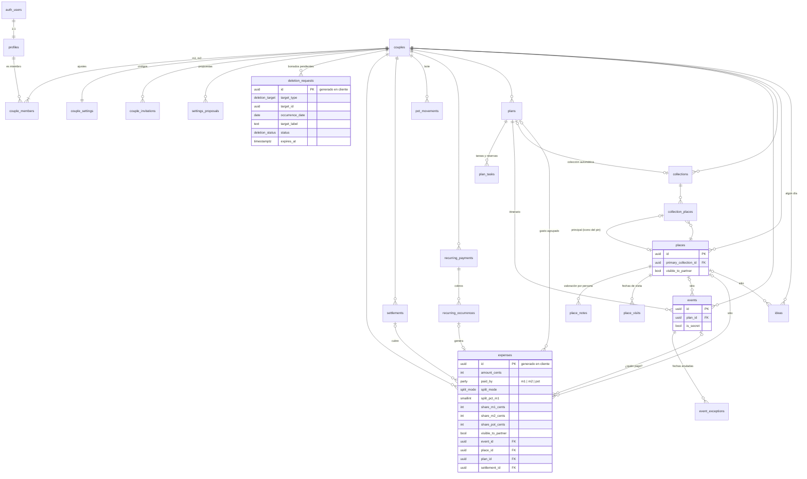

# ito: modelo de datos (Supabase / Postgres)

> 2026-11-13 · Fuentes: `docs/concepto.md`, `docs/especificacion-correcciones.md` (manda), `docs/revision-diseno.md`, los mockups de la ronda 2 y las respuestas de David a la primera versión de este documento.
> Migración: `supabase/migrations/20261113000000_esquema_inicial.sql`.
> Probada en un Postgres 16 embebido (PGlite) con stubs de `auth`, `storage` y Realtime: se crea sin errores y pasan 70 pruebas de humo, entre ellas:
> - Onboarding, repartos y redondeo.
> - Privacidad y saldo de ejemplo de 35,90 €.
> - Liquidación con confirmación, bote y recurrentes.
> - Calendario.
> - Borrados con aprobación.
> - Varias colecciones por sitio.
> - Eventos secretos y Storage.
>
> **No se ha ejecutado contra Supabase.**

## 1. Decisiones clave

1. **Dos huecos fijos por pareja: `m1` y `m2`.** Quien crea el espacio es `m1` y quien se une es `m2`, para siempre. Quién pagó (`paid_by`: `m1`, `m2` o `pot`) y las partes de cada gasto (`share_m1_cents`, `share_m2_cents`, `share_pot_cents`) se guardan por hueco. Así "las partes suman el total" es un `CHECK` de una sola fila, y crear un gasto es un único `INSERT` idempotente (útil sin conexión). La app traduce `m1`/`m2` a "Tú" o "María" con `couple_members`. *Alternativa*: una tabla de partes por persona. Admite más de dos miembros, que una pareja no necesita, pero la suma pasa a necesitar un trigger diferido.
2. **Dinero en céntimos (`integer`)** y porcentajes enteros (de 0 a 100). Las partes las calcula **siempre el servidor**, con una sola regla de redondeo: `m1 = round(total × pct / 100)` y `m2 = total − m1`. En JS, `Math.round(cents * pct / 100)` da lo mismo.
3. **Los saldos no se guardan, se calculan** (vista `expense_effects` + RPC `get_balance()`). No hay totales cacheados que puedan descuadrarse.
4. **Saldar es solo por gastos**: uno, varios, un plan entero o todos. No hay importes libres en el MVP. El servidor calcula la dirección y el importe. Un gasto incluido en una liquidación (pendiente o confirmada) queda bloqueado en importe y reparto, y no se puede borrar hasta deshacerla.
5. **Borrar algo compartido necesita que lo apruebe la otra persona** (§6). Toda petición de borrar pasa por `request_deletion`: lo privado y las colecciones vacías se borran al momento; lo compartido crea una solicitud que la otra persona aprueba o rechaza.
6. **Escrituras delicadas solo por RPC `security definer`**: crear la pareja, unirse, saldar, confirmar, deshacer, aceptar ajustes y borrar. Las tablas no tienen política para esas operaciones, así que el cliente no puede saltárselas.
7. **Privacidad**:
   - Interruptor `visible_to_partner` en gastos, pagos recurrentes, sitios y colecciones.
   - `is_secret` en eventos (§7).
   - Solo puede ser privado algo 100 % tuyo y pagado por ti, así que lo privado nunca afecta al saldo y los dos ven el mismo número.
8. **FK compuestas `(couple_id, x_id)`**: es imposible enlazar nada de otra pareja. Al borrar se usa `ON DELETE SET NULL (x_id)` (PG15+).
9. **Itinerario = eventos con `plan_id`**, con `time_slot` (mañana, tarde o noche) y `position` para ordenar dentro del día.
10. **Un plan es un gasto agrupado** dentro del saldo global. No hay saldo por plan separado.
11. **Bote = cuenta con saldo acumulado**. Un gasto pagado por el bote no genera deudas, aunque se marque como "solo tuyo".
12. **Sitios en varias colecciones** (muchos a muchos), con una colección principal que decide el icono del pin (§8).
13. **Cambios de reparto y bote con la pareja unida**: por propuesta que acepta la otra persona.

## 2. Diagrama entidad-relación

## 3. Tablas

Convenciones comunes:
- `id uuid`, generado por el cliente en todo lo que se pueda crear sin conexión.
- `created_at` y `updated_at` son `timestamptz`.
- `version` (entero que sube en cada `UPDATE`) sirve para la concurrencia optimista.
- `created_by` lo fuerza un trigger a `auth.uid()`. Excepción: al «dejar» una colección compartida, el servidor la traspasa a la pareja (§8).
- Fechas de calendario en `date` local, más `time` cuando hace falta.

### Personas y pareja

| Tabla | Columnas principales | Por qué |
|---|---|---|
| `profiles` | `id` (= `auth.users.id`), `display_name`, `avatar_path` | Se crea sola con un trigger en `auth.users`. |
| `couples` | `currency` (`EUR`), `time_zone` (`Europe/Madrid`) | Moneda única por pareja en el MVP. La zona horaria define el "hoy" de cobros y aportaciones. |
| `couple_members` | PK (`couple_id`, `user_id`), `slot`, `color`, `left_at`, `share_personal_expenses` / `share_personal_recurring` / `share_places` (valor por defecto de "Visible para…"), `notify_*` | `unique (couple_id, color)` impide repetir color. Un usuario solo puede estar en una pareja activa. |
| `couple_invitations` | `code` (6 caracteres sin I/L/O/0/1), `expires_at` (+7 días), `used_by`/`used_at`, `revoked_at` | Un solo uso. `join_couple` acepta `4K7·Q2X`. Máximo 10 intentos por hora (`private.join_attempts`). |
| `couple_settings` | `default_split` (`mixed`, `all_pot`, `half`, `proportional`), `proportional_pct_m1`, `pot_enabled`, `pot_categories[]`, `pot_funding`, `pot_monthly_cents`, `pot_day`, `pot_pct_m1`, `pot_started_on`, `pot_generated_through` | Un solo "Proporcional" con el % editable: no hay "Personalizado" como valor por defecto. Se edita directamente solo mientras no se ha unido la pareja. |
| `settings_proposals` | `changes jsonb`, `status`, `proposed_by`, `decided_by` | Como máximo una pendiente por pareja. La acepta solo la otra persona (`respond_settings_proposal`). |

### Dinero

| Tabla | Columnas principales | Por qué |
|---|---|---|
| `expenses` | `concept`, `amount_cents`, `currency`, `category` (9 fijas), `spent_on`, `paid_by`, `split_mode` (`half`, `proportional`, `custom`, `only_m1`, `only_m2`, `pot`), `split_pct_m1`, `share_*`, `visible_to_partner`, `event_id` / `place_id` / `plan_id` + `*_snapshot`, `receipt_path`, `recurring_occurrence_id`, `settlement_id` | Los `CHECK` garantizan que las partes suman el total y son coherentes con el modo, y que un gasto privado es tuyo y lo pagaste tú. El trigger calcula las partes, exige el bote activado, comprueba la moneda, impide enlazar un evento que no ves y bloquea los gastos saldados. Editar el importe de un gasto no saldado es directo. |
| `settlements` | `from_slot` → `to_slot`, `amount_cents`, `method`, `status` (`pending`, `confirmed`, `rejected`) | Solo lectura para el cliente; se escribe con RPC. |
| `pot_movements` | `kind` (`contribution`, `reimbursement`, `adjustment`), `member_slot`, `amount_cents`, `is_auto` + `period` | La aportación automática es idempotente. Borrar un movimiento requiere aprobación (§6). |
| `recurring_payments` | `amount_cents`, `is_variable`, `frequency` (`once`, `monthly`, `yearly`), `day_of_month`, `month_of_year`, `paid_by`, `split_mode`, `reminder_days`, `visible_to_partner`, `show_in_calendar`, `paused` | Si el importe es fijo, el gasto se crea solo el día del cobro. |
| `recurring_occurrences` | `due_date`, `status` (`pending`, `paid`, `skipped`), `amount_cents` | Se materializan cuando vencen; las futuras se calculan al vuelo. |

### Calendario, planes y mapa

| Tabla | Columnas principales | Por qué |
|---|---|---|
| `events` | `start_date`/`start_time`, `end_date`/`end_time`, `all_day`, `time_slot`, `time_zone`, `starts_at`/`ends_at` (calculados), `recurrence` + `recurrence_until`, `attendees`, `place_id`, `plan_id`, `position`, `budget_cents`, `ask_who_paid`, `who_paid_resolved_at`, **`is_secret`**, **`reserved`** + `reservation_note` (≤ 200) | Mover un evento de día u hora es un `UPDATE` directo, sin aprobación. "¿Quién pagó?" se pregunta 90 minutos después de empezar si no tiene hora de fin. La reserva («a nombre de David, 21:30») vale también para el itinerario de un plan; las reservas por hacer son `plan_tasks` `booking`. Un elemento del itinerario sale en `calendar_range` como evento (`kind = 'event'` con `plan_id`) además de la banda del plan. |
| `event_exceptions` | (`event_id`, `occurrence_date`) | Fechas anuladas de un evento que se repite. Las crea un borrado aprobado ("solo este día") o "editar solo este". |
| `plans` | `type`, `name`, `icon`, `cover`, `start_date`/`end_date`, `attendees`, `budget_cents` (opcional), `default_split_mode` + `default_split_pct_m1` | Un trigger crea y sincroniza su colección automática. |
| `plan_tasks` | `kind` (`booking`, `task`), `assignee`, `status`, `estimated_cents`, `place_id`, `event_id`, `expense_id`, `position` | Se borran directamente: son una checklist. Una reserva (`booking`) con `event_id` se sincroniza en los dos sentidos con `events.reserved` (hecha ⇔ reservado; al enlazar gana «hecho»); una por elemento (`TW072`). |
| `ideas` | `title`, `icon`, `type`, `place_id` | Se borran directamente (al convertirlas también). |
| `places` | `name`, `lat`/`lng`, `provider` + `provider_place_id`, `source_url`, `category`, `status`, **`primary_collection_id`**, `visible_to_partner` | Ver §8. |
| `collection_places` | PK (`collection_id`, `place_id`), `added_by`, `added_at` | Relación muchos a muchos. Quitar un sitio de una colección es directo. |
| `place_notes` | PK (`place_id`, `user_id`), `rating` (de 0,5 a 5), `note` | Valoración y notas de cada persona. |
| `place_visits` | `place_id`, `visited_on` (`date`), `note` (≤ 200), `created_by`, `version`; único (`place_id`, `visited_on`) | Fechas en las que habéis ido (§8 bis). Una por sitio y día. Añadir una pone el sitio en «Hemos ido». |
| `collections` | `name`, `icon`, `plan_id` (único), `visible_to_partner` | La de un plan es visible siempre y se va con el plan (o se queda como normal si se borra el plan). |
| `deletion_requests` | `target_type`, `target_id`, `occurrence_date`, `target_label`, `requested_by`, `status` (`pending`, `approved`, `rejected`, `cancelled`, `expired`), `expires_at` (+7 días), `decided_by` | Ver §6. |
| `push_tokens` | `token`, `user_id`, `platform` | Para Expo Push. |

**Vistas** (con la RLS de quien consulta):
- `expense_effects`, `plan_summaries` y `place_stats` (`visit_count` y `last_visit_on` salen de `place_visits`; `suggested_visit_on`, §8 bis).
- `pending_actions`: las tarjetas de Inicio. Incluye `confirm_settlement`, `who_paid`, `variable_amount`, `settings_proposal` y **`approve_deletion`**.

## 4. Saldos

**Convención:** un efecto positivo significa que m2 debe a m1.

| Quién pagó | Efecto entre los dos | Deuda del bote |
|---|---|---|
| `m1` | `+share_m2` | el bote debe `share_pot` a m1 |
| `m2` | `−share_m1` | el bote debe `share_pot` a m2 |
| `pot` | 0, aunque el reparto sea "solo tuyo" | — |

- **Saldo global** (`get_balance().partner_owes_me_cents`, ya con el signo de quien mira): suma de efectos de los gastos no confirmados como saldados, incluidos los de planes. Lo pendiente de confirmar se devuelve también aparte (`awaiting_confirmation_cents`). Datos de ejemplo: +35,90 € para David y −35,90 € para María.
- **Saldar**:
  - `create_settlement(id, expense_ids[], method)`: si la registra quien recibe el dinero, queda confirmada; si la registra quien paga, queda pendiente.
  - `respond_settlement`: solo quien recibe. Si rechaza, los gastos vuelven a estar abiertos.
  - `undo_settlement`: quien la registró, mientras esté pendiente o hasta 10 minutos después de confirmarla.
  - Bloquea los gastos (`FOR UPDATE`): dos liquidaciones no pueden cubrir el mismo gasto.
  - **Un gasto con una solicitud de borrado pendiente no se puede saldar** hasta que se resuelva.
- **Bote**:
  - Saldo = aportaciones + ajustes − reembolsos − gastos pagados por el bote.
  - "El bote debe X a María" = lo que ella adelantó en gastos del bote − lo que se le ha reembolsado.
- **Qué se guarda**: solo los hechos (gastos con sus partes, liquidaciones y movimientos del bote). Todo lo demás se calcula.

## 5. Seguridad (RLS)

Las funciones auxiliares `private.my_couple_id()`, `my_slot()`, `slot_of()` y `active_member_count()` son `security definer`, para evitar la recursión. En las políticas se usan como `(select …)`.

| Tabla | select | insert | update | delete |
|---|---|---|---|---|
| `profiles` | yo o mi pareja | (trigger) | yo | — |
| `couples` | mi pareja | RPC | mi pareja | — |
| `couple_members` | mi pareja | RPC | solo mi fila (el trigger bloquea `slot`, `couple_id` y `left_at`) | RPC `leave_couple` |
| `couple_invitations` | mi pareja | RPC | RPC | — |
| `couple_settings` | mi pareja | RPC | solo si soy el único miembro | — |
| `settings_proposals` | mi pareja | yo, si somos dos | RPC (la otra persona) | yo, si está pendiente |
| `expenses`, `recurring_payments`, `places`, `collections` | mi pareja **y** (visible **o** mío) | mi pareja, `created_by = yo` | igual que select; solo quien lo creó cambia la visibilidad | **RPC `request_deletion`** |
| `events` | mi pareja **y** (no secreto **o** mío) | mi pareja, `created_by = yo` | igual que select | **RPC `request_deletion`** |
| `plans` | mi pareja | mi pareja | mi pareja | **RPC `request_deletion`** |
| `pot_movements` | mi pareja | mi pareja, no automáticos | mi pareja | **RPC `request_deletion`** |
| `collection_places` | si veo el sitio y la colección | ídem, `added_by = yo` | — | ídem (directo) |
| `event_exceptions` | si veo el evento | si veo el evento | si veo el evento | si veo el evento |
| `place_notes` | si veo el sitio | mi fila, si veo el sitio | mi fila | mi fila |
| `place_visits` | si veo el sitio | si veo el sitio, `created_by = yo` | si veo el sitio | si veo el sitio (directo) |
| `recurring_occurrences` | si veo el recurrente | si veo el recurrente | si veo el recurrente | — |
| `plan_tasks`, `ideas` | mi pareja | mi pareja | mi pareja | mi pareja |
| `settlements`, `deletion_requests` | mi pareja | **RPC** | **RPC** | — |
| `push_tokens` | yo | yo | yo | yo |

Otras protecciones:
- `settlement_id` solo lo cambian las RPC. Un trigger distingue la escritura del cliente (`current_user = 'authenticated'`) de la de una RPC, un job o una acción de FK.
- **Storage**: buckets privados `receipts/{couple_id}/{expense_id}/…` y `avatars/{user_id}/…`. Ver un ticket exige poder ver su gasto.

## 6. Borrados con aprobación de los dos

**Qué necesita aprobación**:
- Borrar un gasto, un sitio, un evento (entero o una fecha de uno que se repite), un pago recurrente o un plan completo.
- Borrar una colección en la que tu pareja ha añadido algún sitio (aunque la colección sea privada). Ver §8.
- Borrar un movimiento del bote (propuesta mía, ver §12).

**Qué no la necesita**:
- Borrar algo privado tuyo: un gasto, pago o sitio no visible, o un evento secreto.
- Borrar una colección sin sitios añadidos por tu pareja (vacía, privada o con solo tus sitios). Si es compartida, por lo general no se borra: la «dejas» y tu pareja la conserva (§8).
- Quitar un sitio de una colección.
- Editar el importe de un gasto no saldado.
- Mover un plan o un elemento del itinerario de día u hora.
- Borrar tareas, ideas, notas, excepciones de eventos o **visitas de un sitio** (las de cualquiera de los dos: es corregir una fecha del sitio, no borrar algo compartido).
- Borrar cualquier cosa mientras la pareja aún no se ha unido (o ya se fue).

**Mecanismo**:
1. El cliente llama a `request_deletion(id, tipo, target_id, fecha_opcional)`, con un `id` generado por él (idempotente). Devuelve:
   - `{status: 'deleted'}` si no necesitaba aprobación: se borra al momento.
   - `{status: 'pending', request_id}` en otro caso: crea una fila en `deletion_requests` con un texto para mostrar ("David quiere borrar «Cena en Taberna El Olivo»") y caducidad a 7 días.
2. Mientras está pendiente, el elemento sigue existiendo y la app lo muestra como **"Pendiente de borrar"**. Lo sabe consultando `deletion_requests` con `status = 'pending'` por `target_id`, que también llega por Realtime.
3. La otra persona lo ve en Inicio (`pending_actions.kind = 'approve_deletion'`) y responde con `respond_deletion(id, true/false)`:
   - Si aprueba, se ejecuta el borrado en el servidor.
   - Si rechaza, el elemento se queda.
   - Quien lo pidió no puede aprobarlo.
4. Quien lo pidió puede retirarlo: `cancel_deletion(id)`.
5. **Caducidad**: a los 7 días sin respuesta pasa a `expired` (lo hace el job diario) y el elemento se queda.
6. **Los dos piden lo mismo**: si la otra persona ya había pedido borrar ese elemento, la segunda petición cuenta como aprobación y se borra.
7. **El elemento desaparece por otra vía** (cascada de un plan, salida de la pareja): un trigger cancela sus solicitudes pendientes.
8. No hay política DELETE en las tablas afectadas, así que un `DELETE` directo desde la API no borra nada. Solo hay un camino.

**Encaje con las liquidaciones**:
- No se puede pedir borrar un gasto incluido en una liquidación, pendiente o confirmada (`TW010`: "deshaz la liquidación para borrarlo").
- A la inversa, un gasto con una solicitud de borrado pendiente no se puede incluir en una liquidación (`TW020`).
- Al ejecutar el borrado se vuelve a comprobar que el gasto no esté saldado.
- Si se borra un gasto pendiente de saldar, el saldo se recalcula solo, porque no hay nada guardado.

**Qué conserva cada borrado**:
- **Gastos**: si se borra lo que tenían vinculado, guardan el nombre del sitio, evento o plan (y el icono del plan) como texto en `*_snapshot`. Un trigger lo copia antes de borrar, también en los gastos privados de la pareja. El título de un **evento secreto** solo se copia en gastos que la pareja no ve.
- **Plan**: se borran su itinerario (eventos con `plan_id`) y sus tareas. Se conservan sus gastos y sus sitios; su colección se queda como colección normal.
- **Colección**: los sitios se quedan; solo se quita la pertenencia. Al «dejarla» (§8) no se borra: pasa a tu pareja.
- **Recurrente**: se borran sus ocurrencias; los gastos ya creados se quedan.
- **Salir del espacio** (`leave_couple`): se borra lo privado y los eventos secretos de quien sale, se cancelan las solicitudes pendientes y lo compartido se queda con la otra persona.

## 7. Eventos secretos

- **Qué es**: `events.is_secret = true` hace que solo lo vea (y lo edite) quien lo creó. Sirve para preparar una sorpresa.
- **Cuándo se marca**: solo al crearlo. Después se puede **revelar** (pasar a `false`), pero un evento compartido **no se puede volver secreto** (`TW051`). La pareja ya lo tiene en su caché y Realtime no le avisaría del cambio, porque la fila dejaría de pasar su RLS.
- **Planes**: un evento secreto **no puede pertenecer a un plan** (`CHECK`). El itinerario y el presupuesto del plan son compartidos, y un hueco invisible los descuadraría. *Alternativa*: permitirlo, con la contrapartida de que el itinerario y los totales del plan serían distintos para cada uno.
- **Gastos vinculados**:
  - Un gasto ligado a un evento secreto sigue la regla general: solo es privado si es 100 % tuyo y pagado por ti. La app lo propone privado por defecto.
  - Si es compartido, la pareja ve el gasto (y su efecto en el saldo) pero no el evento: su consulta del evento no devuelve nada.
  - La pareja no puede enlazar sus gastos a tu evento secreto (`TW060`).
  - Al borrar el evento, su título no se copia en gastos compartidos.
- **Calendario, Inicio y mapa**: `calendar_range`, `pending_actions` ("¿Quién pagó?") y `place_stats` aplican la RLS de quien consulta, así que la pareja no ve nada. También se ocultan las fechas anuladas del evento.
- **Realtime**: Postgres Changes aplica la RLS por suscriptor, así que la pareja no recibe altas ni cambios. Los `DELETE` llegan solo con el id. La Edge Function de avisos debe enviar los recordatorios de un evento secreto solo a quien lo creó.
- **Borrado**: es privado, así que se borra al momento.

## 8. Colecciones: varias por sitio

- `collection_places` es la relación muchos a muchos.
- `places.primary_collection_id` es la colección cuyo icono lleva el pin en la vista general del mapa. Al filtrar por otra colección, la app usa el icono de esa.
- La FK `(primary_collection_id, id) → collection_places` garantiza que la principal es una de las colecciones del sitio.
- **Reglas** (un trigger las aplica):
  - Al entrar en su primera colección, esa pasa a ser la principal.
  - Si se quita la principal, pasa a la colección más antigua que le quede.
  - Si no le queda ninguna, `null`, y el pin usa el icono de su categoría.
  - Para cambiarla a mano: `update places set primary_collection_id = …`.
- **"Quitar de las demás"** al añadir un sitio a otra colección es un `DELETE` directo de sus otras filas en `collection_places`.
- **Colección automática de un plan**: "+ Guardar sitio en Lisboa" inserta en `collection_places` con la colección del plan.
- **Colección privada de tu pareja**: si la principal de un sitio es una colección que no ves, tu pin usa el icono de la categoría.

### Borrar una colección (`20261128000000_colecciones_borrado.sql`)

La primera regla que se cumple decide (`private.collection_deletion_mode`):

| Caso | Resultado |
|---|---|
| Es de un plan | `TW061`: se borra con el plan |
| No hay pareja activa | Se borra |
| **R1** · Tiene algún sitio añadido por otra persona (`collection_places.added_by` ≠ tú; cuenta aunque sea privada o el sitio sea privado de tu pareja) | Pide aprobación (§6); al aprobarla se borra para los dos |
| Privada | Se borra |
| Compartida, vacía y creada por ti | Se borra |
| **R2** · Compartida en cualquier otro caso (con sitios solo tuyos, o creada por tu pareja) | **Se deja**: desaparece para ti y tu pareja la conserva |

**Dejar una colección** (R2), en una transacción:
- `created_by` pasa a la pareja y `visible_to_partner` a `false`: es una colección privada suya. Tú dejas de verla (RLS) y
  ella puede volver a compartirla con «Visible para…» (ya es suya, así que `TW013` no salta).
- Las filas de tus sitios privados (que tu pareja no ve) salen de la colección; los sitios se quedan.
- El resto de filas pasan a `added_by` = pareja: si después la borra ella, no necesita tu permiso.
- Principal: en los sitios que la tenían de principal y están en otra colección compartida, pasa a la más antigua de
  esas (una privada de cualquiera de los dos no, porque el otro perdería el icono). Si no hay, se queda (tu pareja la
  sigue teniendo; tú ves el icono de la categoría).
- Sus solicitudes de borrado pendientes se cancelan. Si había una de tu pareja (quería borrarla), los dos estáis de
  acuerdo y se borra para los dos.
- `created_by` solo lo puede cambiar el servidor: `private.collections_guard` (trigger `a_guard` de `collections`).

**Una compartida no vuelve a ser privada** (`TW054`, como `TW053` en sitios): la pareja la tiene en su caché, Realtime no
le avisaría y podría tener sitios suyos dentro. Privada → compartida sí (solo quien la creó, `TW013`). Solo el servidor la
hace privada, al dejarla (R2).

**Carreras**: `request_deletion` bloquea la colección (`FOR UPDATE`) y decide en otra sentencia. Añadir un sitio pide
`FOR KEY SHARE` sobre la colección (FK), así que espera o ya se ve; dos peticiones sobre la misma colección van en fila.

**Para la app**:
- Borrar: `request_deletion(id, 'collection', colección)` →
  `{status:'deleted'}` borrada · `{status:'deleted', kept_by_partner:true}` dejada (la app la quita de su caché:
  Realtime no avisa a quien deja de verla) · `{status:'pending', request_id}` pendiente de aprobación.
- Antes de confirmar: `preview_collection_deletion(colección)` → `'delete' | 'leave' | 'approval' | 'plan'` (orientativo).

**Supuestos a confirmar con David**: (a) una compartida vacía se borra si la creaste tú y se deja si la creó tu pareja;
(b) tus sitios privados salen de la colección al dejarla; (c) la principal pasa a otra colección compartida del sitio si
la tiene. Si la pareja **rechaza** el borrado, la colección sigue para los dos (como el resto de §6).

## 8 bis. Fechas de visita (`20261129000000_visitas_y_reserva.sql`)

- **Modelo**: `place_visits`, una fila por día que habéis ido. Sin «con quién»: sois los dos. Visibilidad heredada del
  sitio (como `place_notes`): las de un sitio privado solo las ve su dueño, y al revelarlo las ve la pareja. Se borran
  con el sitio.
- **Estado**: añadir una visita pone el sitio en «Hemos ido» (trigger). Quitar visitas o volver a «Quiero ir» no toca
  el otro lado. Un sitio puede estar en «Hemos ido» sin visitas: se muestra «sin fecha» (los que ya lo estaban antes de
  la migración se quedan así; no se inventan fechas).
- **Quién edita**: los dos, directo, cualquier visita de un sitio que ven (§6).
- **Reglas del servidor**: el sitio tiene que verse (`TW064`); fecha como mucho un día por delante del «hoy» de la
  pareja (`TW065`; el margen es para quien viaja a otra zona horaria) y desde 1950; una por sitio y día (`23505`);
  `place_id` no cambia en un `UPDATE`.
- **`place_stats`**: `visit_count` = visitas apuntadas (antes, fechas distintas de gastos y eventos pasados; ya no, para
  no contar dos veces ni mostrar visitas que no se pueden quitar). `last_visit_on` = la más reciente.
  `suggested_visit_on` = la fecha más reciente de un evento único ya terminado o de un gasto del sitio posterior a la
  última visita: la ficha ofrece «¿Fuisteis el vie 14? Añadir visita».
- **Inicio** («Último lugar visitado»): la visita más reciente de `place_visits`.

## 9. Sin conexión

- **Qué funciona**: crear gastos (la cola de "pendiente de subir"). Editar, borrar (o pedir borrar) y saldar requieren conexión.
- **Idempotencia**: los `uuid` los genera el cliente. Los gastos se suben con `upsert(..., { onConflict: 'id', ignoreDuplicates: true })`, y el ticket va después a Storage. Las liquidaciones y las solicitudes de borrado también llevan un `id` del cliente.
- **Conflictos al editar**: `update(...).eq('id', id).eq('version', v)`. Si afecta a 0 filas, la otra persona lo cambió: se recarga y se avisa.
- **Gasto rechazado al sincronizar** (por ejemplo, el bote se desactivó entretanto, `TW012`): se queda en la cola como "No se pudo subir".
- **Lectura**: caché local persistida y recarga al volver la conexión.

## 10. Tiempo real

Publicación `supabase_realtime`:
- **Dinero**: `expenses`, `settlements`, `pot_movements`, `recurring_payments`, `recurring_occurrences`.
- **Planificación**: `events`, `event_exceptions`, `plans`, `plan_tasks`, `places`, `place_notes`, `place_visits`, `collections`, `collection_places`, `ideas`.
- **Pareja**: `couple_members`, `couple_settings`, `settings_proposals`, `deletion_requests`.

Hay que suscribirse con el filtro `couple_id=eq.<id>`. La RLS se aplica por suscriptor, así que no llegan los gastos privados ni los eventos secretos de la pareja. Los `DELETE` llegan solo con la clave primaria.

## 11. Índices (por pantalla)

| Pantalla / consulta | Índice |
|---|---|
| Historial por mes | `expenses (couple_id, spent_on desc, created_at desc)` |
| Filtro por categoría | `expenses (couple_id, category, spent_on desc)` |
| Búsqueda en el historial | GIN `pg_trgm` sobre `concept` |
| Saldo, Saldar | parcial `expenses (couple_id) where settlement_id is null`, `expenses (settlement_id)`, parcial `settlements (couple_id) where status = 'pending'` |
| Gastos de un plan, evento o sitio | `expenses (plan_id)`, `(event_id)`, `(place_id)` |
| Calendario por rango | `events (couple_id, start_date)`, `plans (couple_id, start_date, end_date)` |
| Itinerario | `events (plan_id, start_date, position)` |
| "¿Quién pagó?" pendiente | parcial `events (couple_id, ends_at) where ask_who_paid and who_paid_resolved_at is null` |
| Mapa | `places (couple_id, status)`, `collection_places (place_id, added_at)`, PK `collection_places (collection_id, place_id)` |
| Visitas de un sitio, último lugar visitado | único `place_visits (place_id, visited_on)`, `place_visits (couple_id, visited_on desc)` |
| "Pendiente de borrar" | parcial `deletion_requests (target_id) where status = 'pending'`, único parcial por elemento |
| Cobros pendientes | `recurring_occurrences (couple_id, status, due_date)` |
| Bote | `pot_movements (couple_id, occurred_on desc)` |

Todas las FK tienen índice. No se usa PostGIS.

## 12. Job diario y avisos

`private.run_daily_jobs()` es idempotente y se programa con pg_cron si está activado. Cada día:
1. Caduca las solicitudes de borrado de más de 7 días.
2. Crea las aportaciones automáticas al bote.
3. Materializa los cobros recurrentes vencidos:
   - Importe fijo: crea el gasto.
   - Importe variable: deja el cobro pendiente del importe real.

Las notificaciones push van en una Edge Function y en *database webhooks*. Entre ellas: "María quiere borrar…" (alta en `deletion_requests`) y "David ha aprobado / rechazado" (cambio de estado).

## 13. Errores

La app los traduce por `error.code`:

| Código | Significado |
|---|---|
| `TW001` | Sin pareja o no autenticado |
| `TW002` | Ya en una pareja |
| `TW003` | Pareja completa |
| `TW010` | Gasto saldado: no se puede cambiar el importe ni borrar |
| `TW011` | Un elemento privado debe ser tuyo y pagado por ti |
| `TW012` | Bote no activado |
| `TW013` | Solo quien lo creó cambia la visibilidad |
| `TW014` | Moneda distinta a la de la pareja |
| `TW015` | `settlement_id` no editable |
| `TW020`–`TW022` | Liquidación no válida (incluye gasto pendiente de borrar), no pendiente, no se puede deshacer |
| `TW030` | Propuesta no válida |
| `TW040` | Membresía no editable |
| `TW050` | Fechas del evento |
| `TW051` | Un evento compartido no se puede volver secreto |
| `TW052` | Rango de fechas del calendario no válido |
| `TW053` | Un sitio compartido no puede volver a ser privado |
| `TW054` | Una colección compartida no puede volver a ser privada |
| `TW060` | No encontrado / no visible |
| `TW061` | La colección de un plan se borra con el plan |
| `TW062` | Solicitud ya resuelta o caducada |
| `TW063` | La solicitud la tiene que aprobar la otra persona |
| `TW064` | Sitio no encontrado o no visible (al enlazarlo a un gasto, evento, tarea o idea, o al apuntarle una visita) |
| `TW065` | Fecha de visita futura |
| `TW066` | Un gasto de un plan lo veis los dos: no puede ser privado |
| `TW067` | Elemento del itinerario fuera de las fechas de su plan (al crearlo o cambiarle el día) |
| `TW068` | `move_plan`: la pareja ha cambiado el plan mientras tanto (versión distinta) |
| `TW069` | Un evento no cambia de plan: `plan_id` solo se fija al crearlo (ni entra en un plan, ni sale, ni pasa a otro) |
| `TW070`–`TW071` | Bote: reembolso o ajuste no válido (el bote no debe tanto) · ya había otro movimiento con ese id |
| `TW072` | Un elemento del itinerario ya tiene una reserva enlazada (como mucho una `plan_tasks` `booking` por `event_id`) |

`join_couple` devuelve `{ok:false, error}` con uno de estos valores: `invalid_code`, `code_used`, `code_expired`, `couple_full`, `too_many_attempts`, `already_in_couple`.

## 14. Decisiones tomadas por David (13 nov)

1. Si paga el bote no hay deuda, aunque el gasto sea "solo tuyo".
2. Ajustes de dinero por propuesta que acepta la otra persona.
3. Saldar solo por gastos en el MVP.
4. Código de invitación de 6 caracteres.
5. Un solo "Proporcional" con el % editable como reparto por defecto.
6. Borrar un plan borra su itinerario y conserva sus gastos y sus sitios.
7. Varias colecciones por sitio, con una principal para el icono.
8. Eventos y planes compartidos por defecto, con eventos secretos.
9. Los recurrentes de importe fijo crean el gasto el día del cobro.
10. Borrar algo compartido requiere la aprobación de los dos.

## 15. Pendiente de decisión (con mi recomendación)

1. **Borrar movimientos del bote con aprobación.** No estaba en la lista de David, pero cambia el saldo del bote igual que borrar un gasto cambia el saldo entre los dos. **Recomendación: sí**, ya implementado.
2. **Tareas, ideas y notas se borran sin aprobación.** Son listas de trabajo, no dinero ni sitios. **Recomendación: así**, ya implementado.
3. **Borrar una sola fecha de un evento que se repite** (por ejemplo, el aniversario de este año) también pide aprobación, porque es borrar algo compartido. "Editar solo este" no la pide, porque es una edición. **Recomendación: así.**
4. **Las solicitudes de borrado caducan a los 7 días** y el elemento se queda. **Recomendación: 7 días**, igual que la invitación.
5. **Los eventos secretos no pueden estar en un plan.** **Recomendación: así en el MVP.** Si se quiere una sorpresa dentro de un viaje, se crea como evento suelto en esas fechas.

## 16. Riesgos y notas

- **Google Places**: el `place_id` se puede guardar sin límite; las coordenadas, solo hasta 30 días. Para uso personal no es un problema; si se publica, hay que refrescarlas.
- **Sitios privados en algo compartido**: si David enlaza un sitio privado a un evento compartido, María ve el evento sin sitio. La app debería ofrecer hacerlo visible.
- **Sitio duplicado**: resuelto en `20261126000000_mapa.sql`: índice único de compartidos por pareja y de privados por persona; un privado de David no impide a María guardar el mismo sitio. Revelar un privado que ya está compartido da `23505`.
- **Céntimo impar** en "a medias": lo paga siempre m1.
- **Escrituras con `service_role`** (Edge Functions): no fuerzan `created_by` y deben fijarlo explícitamente.
- La migración requiere **Postgres 15 o superior**. Si `pg_cron` no está activado, hay que activarlo y ejecutar el `cron.schedule` del final.
